<!--
  Draft of the Modrinth project description. Before publishing:
  - The images load from the public GitHub repo (raw.githubusercontent.com, main branch), so this
    text can be pasted into Modrinth as it is. Upload docs/logo.png as the project icon; putting the
    docs/images/*.webp shots in the project's Gallery too is optional.
  - Check the version numbers and the "Versions" section against the files you upload.
-->

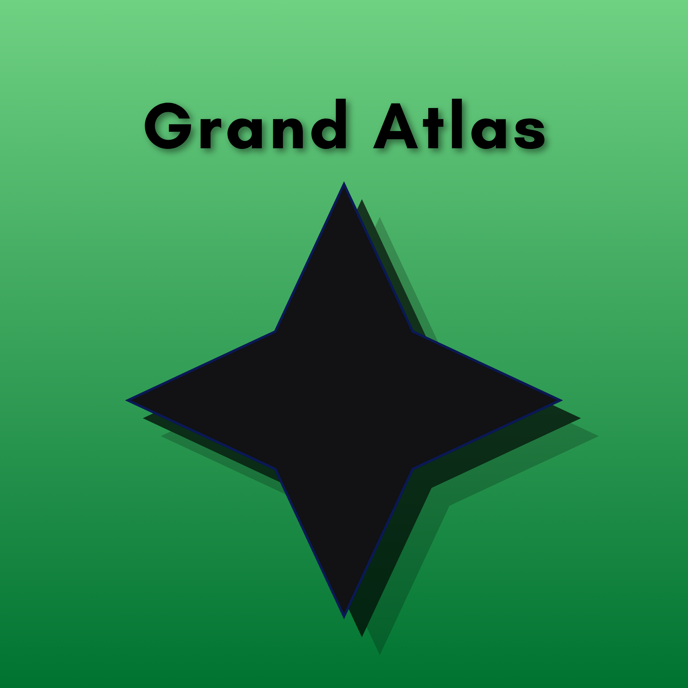

# Grand Atlas

**A complete overhaul of the Overworld: towering landforms, real river systems and a world that goes
512 blocks underground, built to feel hand-made.**

Grand Atlas replaces Minecraft's terrain and biome placement from the ground up. Mountain ranges
rise past y 700, rivers run from mountain springs to the sea through waterfalls and lake districts,
and beneath it all lies a world of caverns, underground seas and set pieces you will remember.

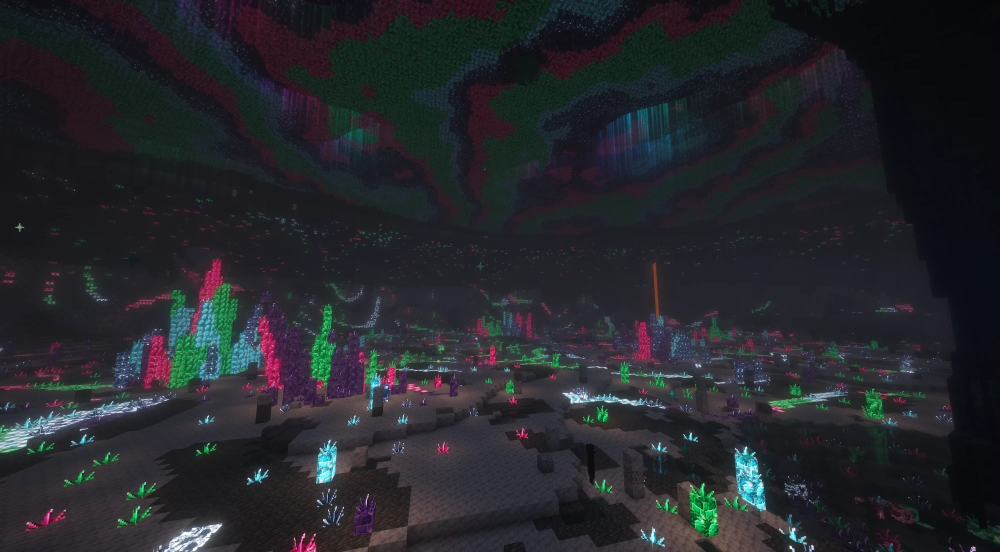

> **About the screenshots:** some were taken in the Create Atlas modpack, so they can show blocks,
> builds and mobs from that pack's other mods (the airships by the volcano, for example). Grand Atlas
> makes the terrain, biomes, caves and features. All screenshots use a shader pack (see Recommended).

---

## What you'll find

### Landforms on a grand scale
- Great plateaus, massifs, basins and mesas several kilometres across, with ordinary country laid
  over them.
- Mountain ranges up to y 1024, some smooth and rolling, some aggressive with jagged towers and
  overhangs.
- Fjords, calderas with crater lakes, karst country, hoodoo gardens, tor hills, cinder fields,
  sinkholes and cenotes.
- Coasts with beaches, cliffs, sea stacks, natural arches, sea caves and salt marshes.

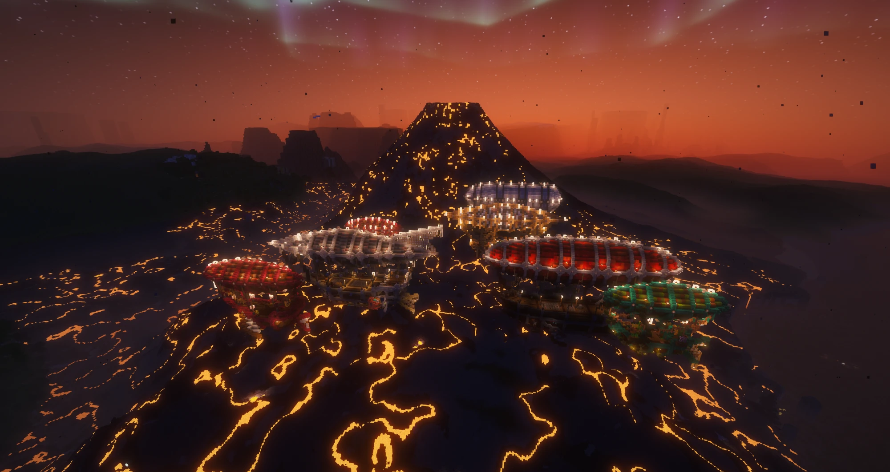

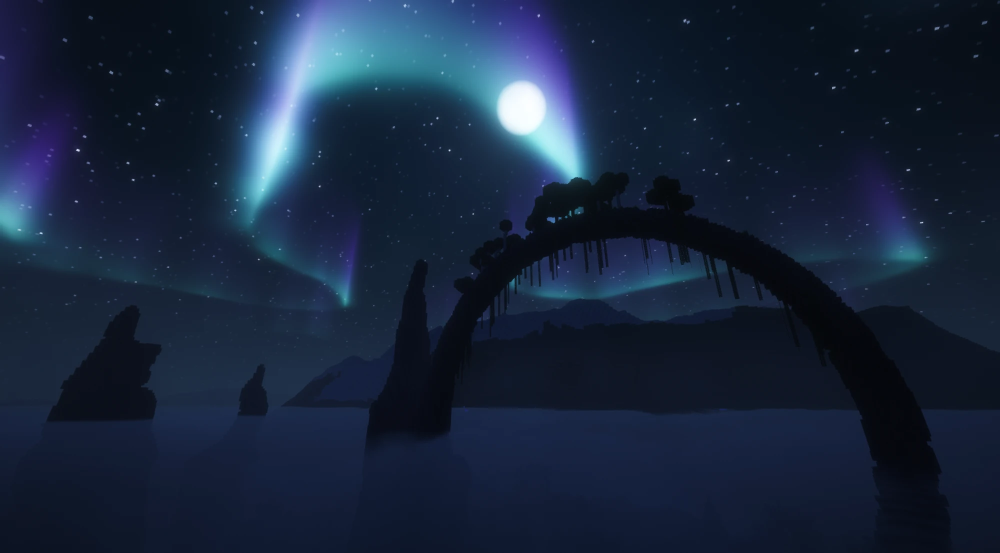

### Water that makes sense
- A real drainage network: every river finds its way to the sea, cuts its own valley and widens as
  tributaries join it.
- Waterfalls everywhere water meets a drop, from step-pool cascades to designed set-piece falls.
- Lakes that sit in real basins, at any height, without the floating water and leaks of vanilla.
- River water carries a current that pushes swimmers, boats and items downstream.

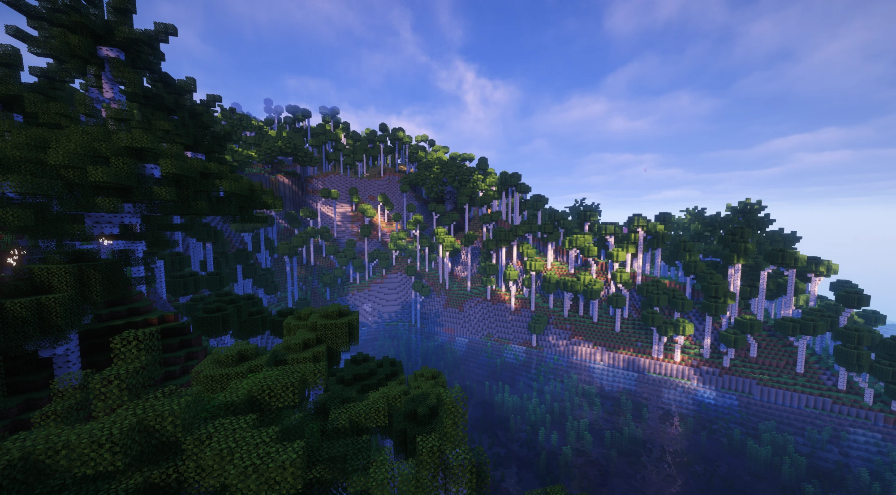

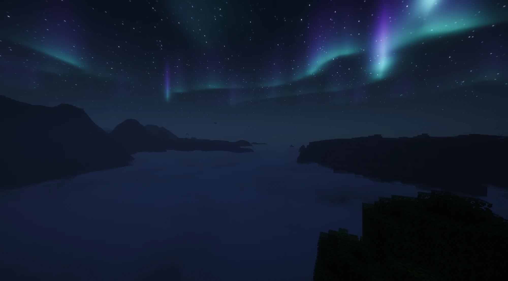

### A world 512 blocks deep
- The world floor is at y -512, with the abyss's tuff and blackstone layers near the bottom.
- Cave networks, worm bores, mega-caverns and rifts, with underground lakes and seas.
- New cave biomes: crystal caves, fungal forests, ice caves, magma chambers, glowworm grottos, root
  caves, sandstone caves and abyssal shores, with new blocks drawn to fit vanilla.
- Ancient cities moved down into the abyss where the deep dark now is.

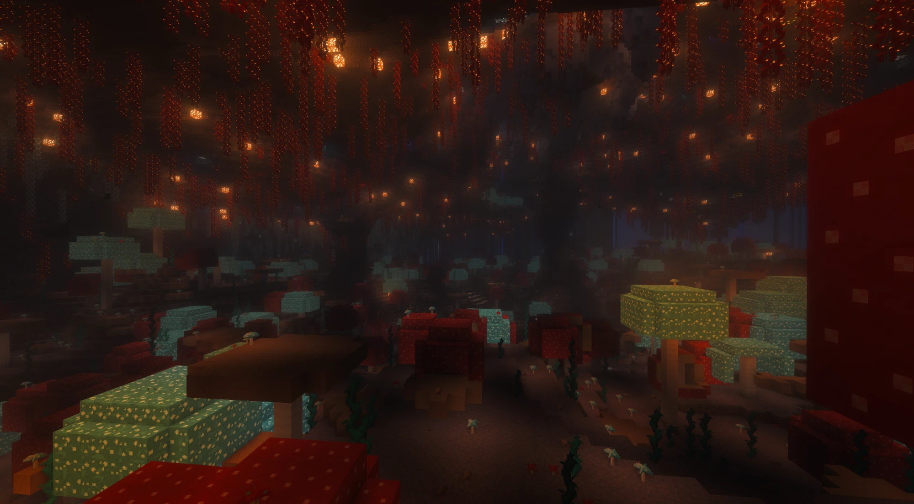

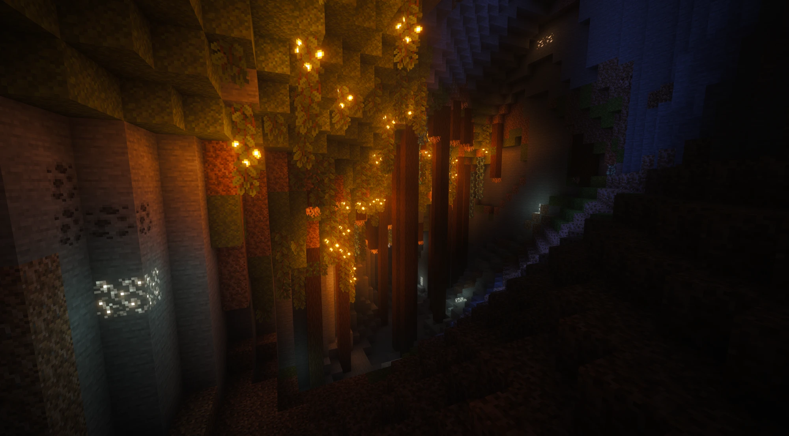

### Set pieces
Rare, hand-designed places generated into the world:
- **Aurora Vaults** — a vast hall under a hanging lake, its floor a garden of aurora crystals and
  the aurora itself rippling through the water above.
- **The Worldroot** — a world tree on the surface whose roots reach down to a great hall far below.
- **The Hollow** — a cavern of floating islands over an underground lake.
- **Great Geodes** and **Titan's Graves**, among others.

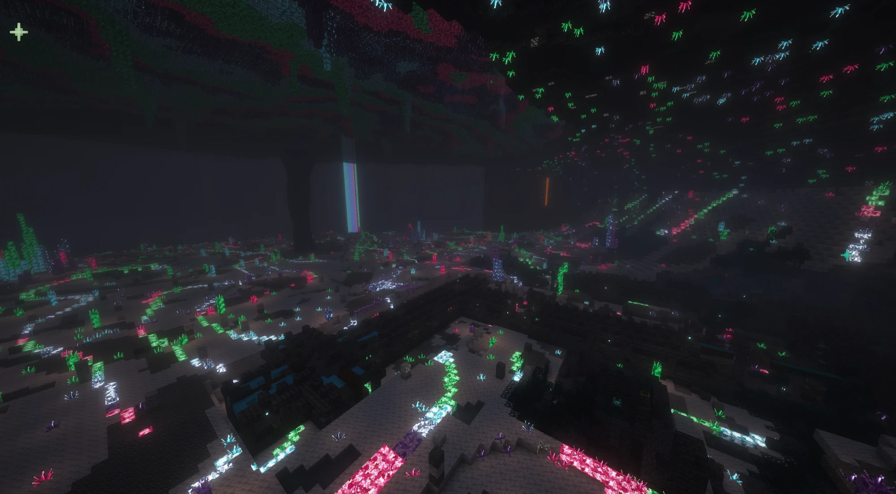

### A world that feels made by hand
- **Landmarks:** god trees 80 to 180 blocks tall, natural arches, spires and pillar mountains.
- **Named places:** every set piece, landform and landmark has a name of its own, shown as you
  arrive.
- **A chosen spawn:** new worlds start in green country by a river or lake, with high ground in view.
- **Every forest biome**, in families: birch woods, dark forests with pale gardens inside them,
  flower forests and cherry groves side by side, old growth taiga, bamboo in the jungle.
- **Villages by the water:** vanilla villages settle beside rivers and lakes.
- Thousands of hand-built trees and rock formations from community asset packs (see Credits),
  re-skinned to match each biome.

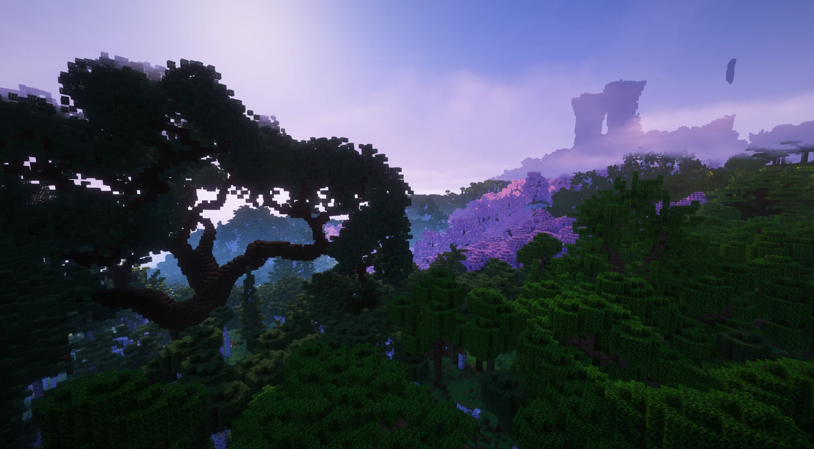

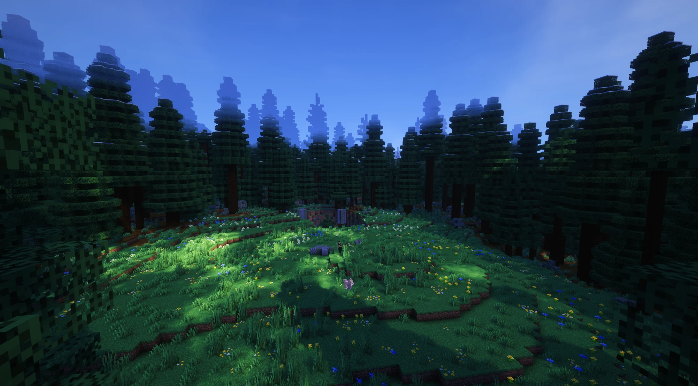

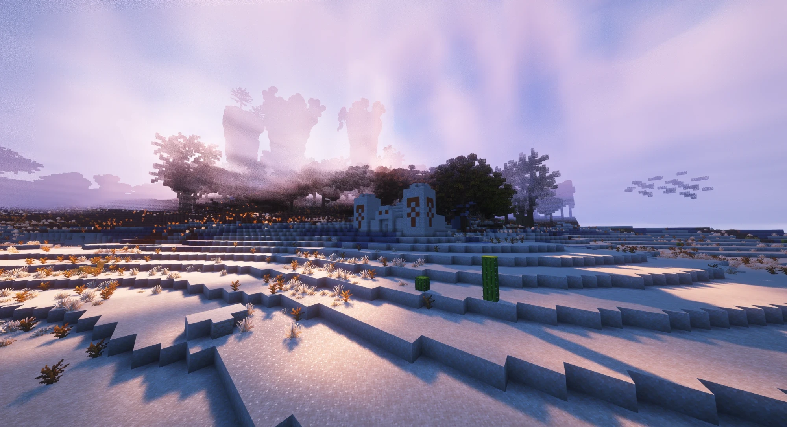

---

## Versions

| Minecraft | Loader | Notes |
|---|---|---|
| **26.3** | NeoForge | The main version. |
| **1.21.1** | NeoForge 21.1.197 or newer | A backport with the same terrain. Install **[Vanilla Backport](https://modrinth.com/mod/vanillabackport)** for the newer blocks and biomes Grand Atlas uses (Pale Garden, Sulfur Caves, leaf litter, dry grass and more); without it those are swapped for 1.21.1 stand-ins. |

**Grand Atlas needs a new world.** It cannot change terrain that has already been generated.

## Recommended

- **Shaders:** Grand Atlas is designed and tested with **Lumina Shaders: Event Horizon** by Benjiaa
  ([Modrinth](https://modrinth.com/project/9gxVXUDr)). On lower-end hardware use **Lumina Shader Lite**
  ([Modrinth](https://modrinth.com/shader/lumina-shader-lite)), from the same author. Grand Atlas's
  river water is shaded as water by shader packs, and the aurora shows through the water.
- **[Better Trees](https://modrinth.com/datapack/better-trees)** by EMD0123 reshapes the game's own
  trees to sit well beside Grand Atlas's.
- **[Distant Horizons](https://modrinth.com/mod/distanthorizons)**, to see the mountain ranges from
  far away.
- **1.21.1:** **[C2ME](https://modrinth.com/mod/c2me-neoforge)** generates chunks in parallel and makes a
  large difference to Grand Atlas's generation speed.

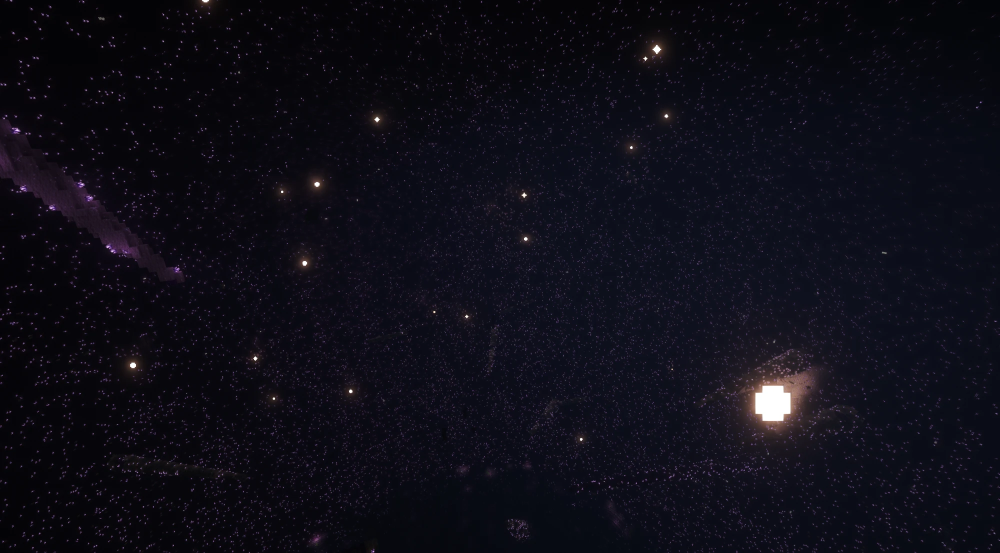

## Compatibility

- **Not compatible with other terrain mods** such as Tectonic or Terralith: Grand Atlas replaces the
  same parts of the game. The game will tell you if one is installed.
- Structure mods work: villages, dungeons and other mods' structures generate in Grand Atlas's terrain,
  and may break into its caves and set pieces. Only the parts of set pieces that would break when
  built through are kept clear.
- Biome mods that add Overworld biomes through the vanilla biome system will not appear: Grand Atlas
  places all Overworld biomes itself.

---

## Credits

Grand Atlas places hand-built trees and rock formations made by other people, used with thanks under
the terms each author published. If you are one of these authors and want something changed or removed,
please get in touch.

| Work | Author | Used for |
|---|---|---|
| **[1k - Treepack](https://www.planetminecraft.com/project/1k-treepack-by-h2co3/)** | H2CO3 | The mixed trees in every wooded biome: 300 of the pack's trees, re-skinned in each biome's own wood and leaves. |
| **[The God Tree-Pack](https://www.planetminecraft.com/project/the-god-tree-pack/)** | Plutouthere (renders by Freekm1234 and Arcaniax) | The landmark god trees: 34 of the pack's trees. |
| **[Landscaping Mega Schematic Pack](https://www.planetminecraft.com/project/landscaping-mega-schematic-pack-1-21-11-axiom-blueprints-included/)** | Dannypan | Outcrops, natural arches, spires, pillar mountains, fins, spike clusters and stone rings: 527 of the pack's pieces. |
| Trees in the Landscaping pack's decorated pieces | paleozoey | On top of some outcrops, arches and pillar mountains. |

The mod does not contain these authors' schematic files. A selection is converted into Grand Atlas's own
packed format, which is not a schematic and cannot be loaded as one.

**Shaders:** Lumina Shaders: Event Horizon and Lumina Shader Lite are by Benjiaa, based on Complementary
Shaders by EminGT. They are separate downloads and are not included with Grand Atlas.

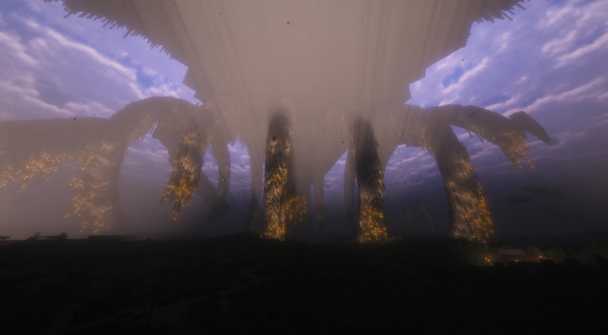
