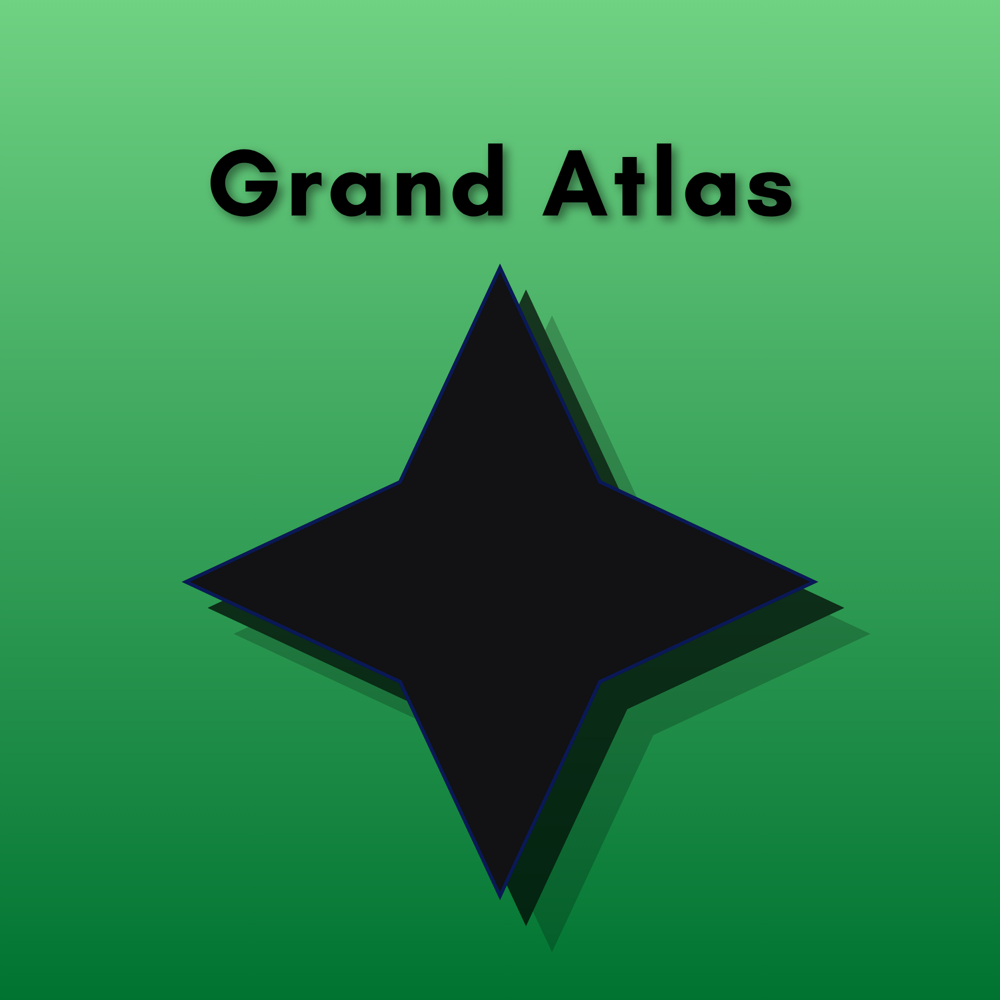
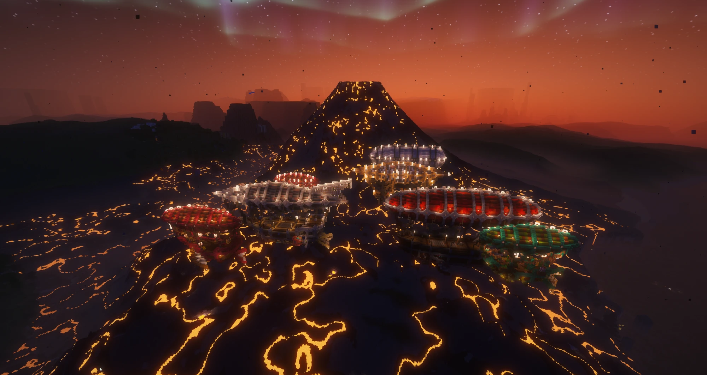
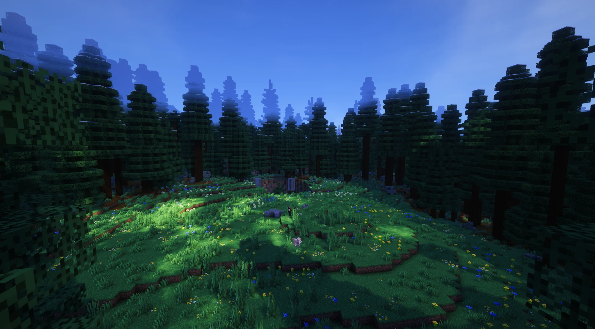

# Grand Atlas


One-stop terrain and biomes for **Minecraft 1.21.1 on NeoForge**: oversized real-world and fantasy landforms, real river systems and a world that runs from y -512 to 1024, blended without seams. **Version 1.0.0.** Download it on Modrinth; the player-facing description and the roadmap are in [MODRINTH.md](MODRINTH.md), the changes in [CHANGELOG.md](CHANGELOG.md).

Made by **AbyssLotus** (W.74 on Modrinth). Licensed under the [Grand Atlas License 1.0](LICENSE.md); third-party trees and rock formations are credited in [docs/CREDITS.md](docs/CREDITS.md).

**Building:** `gradlew :mc1211:build -Prelease` makes the release jar in `mc1211/build/libs`. Without `-Prelease` the build keeps work in progress for a later version.

## Screenshots

> [!NOTE]
> Some of these screenshots were taken in the **Create Atlas** modpack, so they can show things that are not part of Grand Atlas, such as blocks, builds and mobs from the pack's other mods (the airships in the first shot, for example). Grand Atlas makes the terrain, biomes, caves and features. Every shot uses a shader pack, so lighting and sky look different without one.

<p align="center">
  
</p>
<p align="center"><em>A stratovolcano in the Volcanic Wastes, lava veining its slopes, with desert crags behind. The airships come from the Create Atlas modpack.</em></p>

<p align="center">
  
  
</p>
<p align="center"><em>Left: a natural arch and sea stacks under the aurora. Right: the aurora over a sea inlet.</em></p>

<p align="center">
  
  
</p>
<p align="center"><em>Left: a great oak over mixed forest and a cherry grove, with rock towers and a floating rock in the mist. Right: a flower glade in old-growth taiga.</em></p>

<p align="center">
  
  
</p>
<p align="center"><em>Left: birch woods on the steep shore of a lake. Right: the night sky over a violet crystal spire.</em></p>

<p align="center">
  
  
</p>
<p align="center"><em>Left: a fungal forest underground, giant glowcaps and mushrooms under red weeping vines. Right: root caves under a forest.</em></p>

## What you'll find

**A world four times as tall.** The ground runs from y -512 up to y 1024, so mountains can be mountains
and caves can go deep.

**Landforms on a grand scale.** The world is a patchwork of regions a kilometre or two across, each with
its own kind of land: rolling lowlands, hills and highlands, and wonders like towering mountain ranges
with bowl-shaped cirques, canyon country, sand seas, salt flats and red rock deserts full of towers,
fins and natural arches. Every few kilometres something bigger takes over a whole region: a great
plateau with a lake and waterfall on top, a domed massif, a ringed basin, a crater, a lone monolith, or
one of the fantasy giants like a crown of stone spires or a pillar with a garden in the sky.

**Rivers that make sense.** Rain finds its way downhill to the sea. Springs become streams, streams join
into rivers, and lakes fill real hollows. Rivers carve their own valleys, step down through pools and
waterfalls in the hills, and cut gorges where they must. River water has a current that carries you,
your boat and your items downstream.

**Smaller places to stumble on.** Pond country, sinkholes and cenotes, hoodoo gardens, cinder cones,
basalt columns and forest glades, dressed with lily pads, vines, boulders and fallen logs.

**Everything fits together.** Landforms blend into each other without seams: cliffs where cliffs make
sense, gentle slopes where they don't. Biomes follow the land, including Grand Atlas's own salt flats,
red deserts and rivers.

**Underground.** Cave networks, deep pits, rifts and huge caverns, underground lakes and seas, new cave
biomes, and rare set pieces like the Aurora Vaults and the Worldroot.

Use `/grandatlas where` to see what kind of land you're standing on, and the **Grand Atlas** guide book
(crafted from a book, a map and a compass) to keep track of everywhere you've been.

## For developers

The terrain logic is plain Java with no Minecraft code (`src/main/java/com/seaweed/grandatlas/core`);
the Minecraft 1.21.1 mod is in `mc1211/`. [docs/DESIGN.md](docs/DESIGN.md) has the full design.

```
gradlew :mc1211:build -Prelease   # the release jar, in mc1211/build/libs
gradlew checkCore                 # the terrain self-check
gradlew preview                   # PNG maps of the terrain, without starting Minecraft
```

## License

Grand Atlas uses its own [Grand Atlas License](LICENSE.md): free to use, change, port and share with credit; any modpack (monetized too) and any videos or streams are fine; servers only if they make no money; any other way of making money with it needs permission. The third-party trees and rock formations in [docs/CREDITS.md](docs/CREDITS.md) stay under their authors' terms and are not covered.

## Made with AI

This Mod was made with the help of Ai. All concepting, design, testing, as well as code review was performed by a human (Me!). I know how to Code in Java, but do not know the ins and outs of Minecraft modding and while I am learning most of the code in this project was generated with - Claude Code, Opus 5.5.
