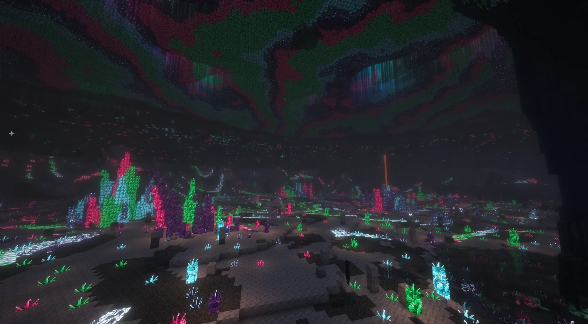
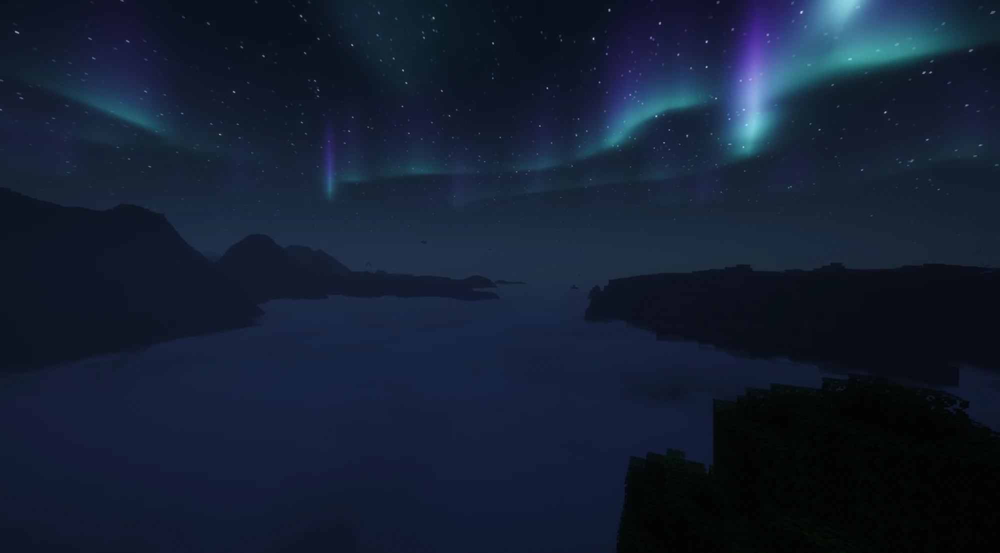
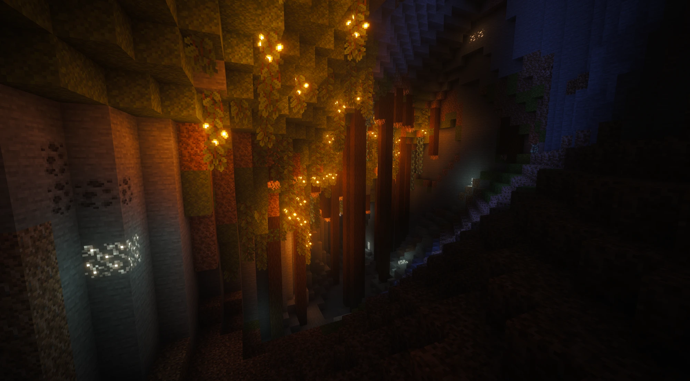
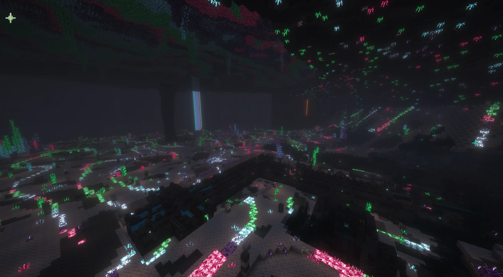
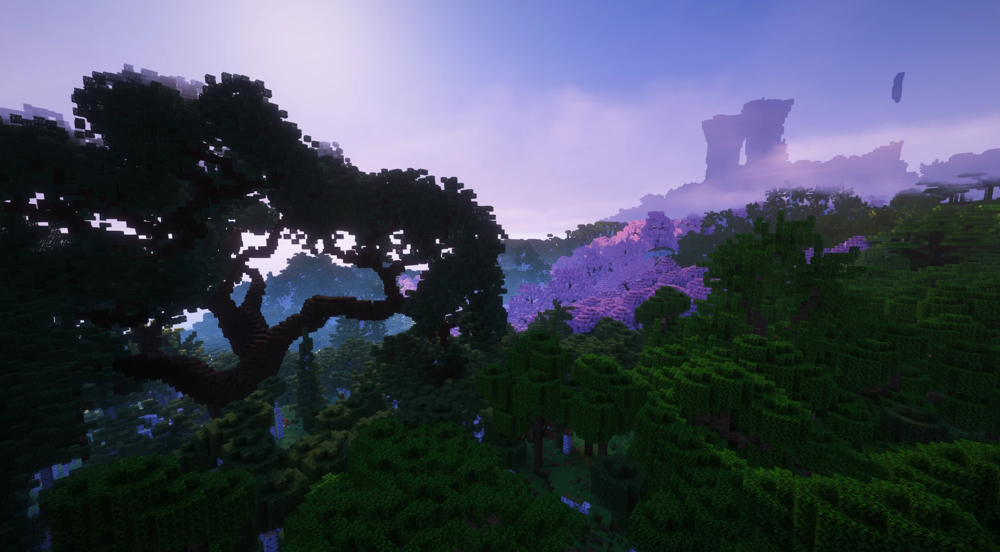
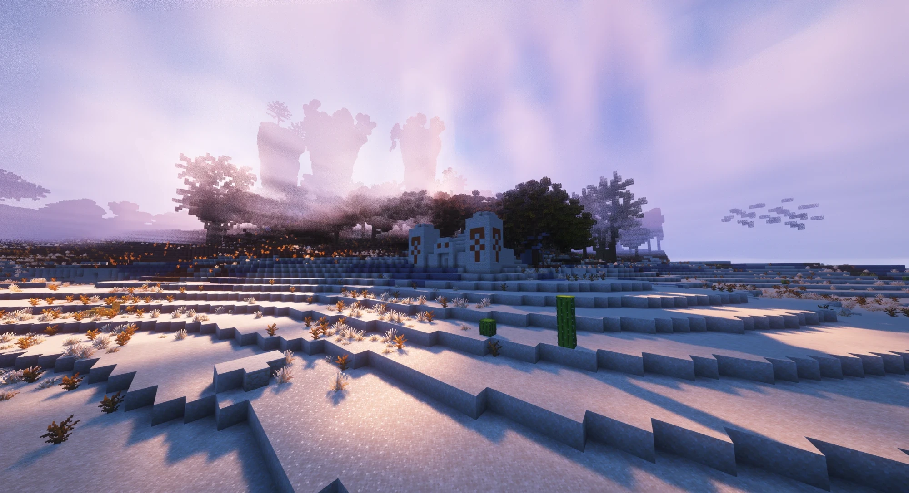
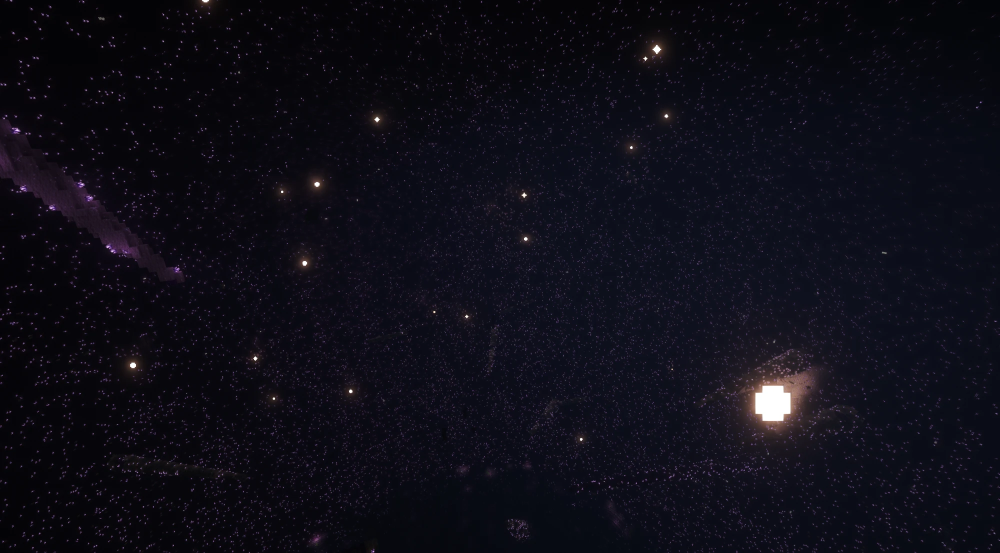
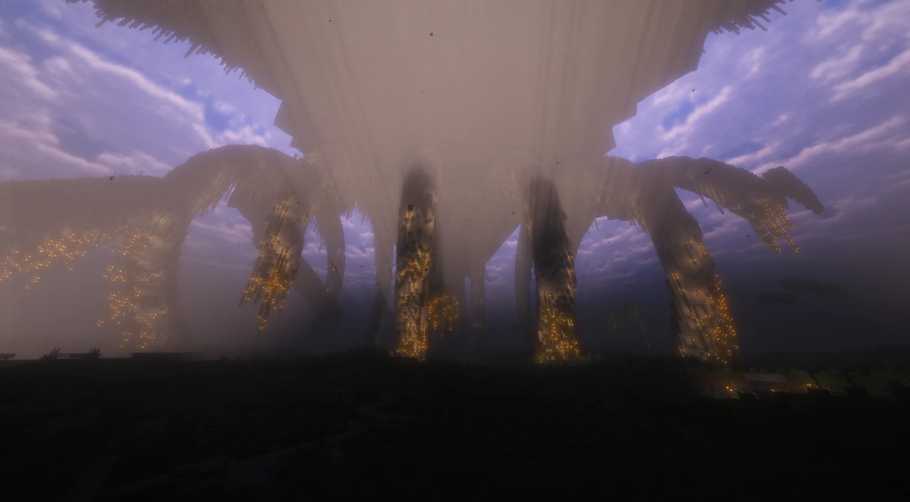

# Grand Atlas

**A complete overhaul of the Overworld: towering landforms, real river systems and a world that goes
512 blocks underground, built to feel hand-made.**

Grand Atlas replaces Minecraft's terrain and biome placement from the ground up. Mountain ranges
rise past y 700, rivers run from mountain springs to the sea through waterfalls and lake districts,
and beneath it all lies a world of caverns, underground seas and set pieces you will remember.



> **About the screenshots:** some were taken in the Create Atlas modpack, so they can show blocks,
> builds and mobs from that pack's other mods (the airships by the volcano, for example). Grand Atlas
> makes the terrain, biomes, caves and features. All screenshots use a shader pack (see Recommended).

---

## What you'll find

### Landforms on a grand scale
- Great plateaus, massifs, basins and mesas several kilometres across, with ordinary country laid
  over them.
- Mountain ranges up to y 1024, some smooth and rolling, some aggressive with jagged towers and
  overhangs.
- Fjords, calderas with crater lakes, karst country, hoodoo gardens, tor hills, cinder fields,
  sinkholes and cenotes.
- Coasts with beaches, cliffs, sea stacks, natural arches, sea caves and salt marshes.


### Water that makes sense
- A real drainage network: every river finds its way to the sea, cuts its own valley and widens as
  tributaries join it.
- Waterfalls everywhere water meets a drop, from step-pool cascades to designed set-piece falls.
- Lakes that sit in real basins, at any height, without the floating water and leaks of vanilla.
- River water carries a current that pushes swimmers, boats and items downstream.




### A world 512 blocks deep
- The world floor is at y -512, with the abyss's tuff and blackstone layers near the bottom.
- Cave networks, worm bores, mega-caverns and rifts, with underground lakes and seas.
- New cave biomes: crystal caves, fungal forests, ice caves, magma chambers, glowworm grottos, root
  caves, sandstone caves and abyssal shores, with new blocks drawn to fit vanilla.
- Ancient cities moved down into the abyss where the deep dark now is.




### Set pieces
Rare, hand-designed places generated into the world:
- **Aurora Vaults** — a vast hall under a hanging lake, its floor a garden of aurora crystals and
  the aurora itself rippling through the water above.
- **The Worldroot** — a world tree on the surface whose roots reach down to a great hall far below.
- **The Hollow** — a cavern of floating islands over an underground lake.
- **The Hanging Mountains** — a cavern deep in the abyss whose roof hangs a whole mountain range upside
  down, its icy peaks reaching down over a still lake that mirrors them.
- **Great Geodes** and **Titan's Graves**, among others.



### Real-world wonders
- **Tepuis** — table mountains rising sheer out of the jungle on walls 230 to 400 blocks tall, streams
  pouring off their rims in falls that drop all the way to the forest below.
- **Rift valleys** — a flat savanna floor sunk between walls that climb in great fault scarps, with
  volcanoes standing on the floor.
- **Rainbow mountains** — sharp ridges striped from foot to crest in red, orange, gold, cream, green,
  teal and lavender.
- **Spotted lakes** — dried-back lakes of round pools, each its own colour, walled apart by white crust.
- Calderas, karst and cenotes, fjords, Ha Long Bay-style island seas, salt playas and more.

### High fantasy
- **The Misty Peaks** — granite needles up to 320 blocks tall standing out of a gorge-cut upland, high
  enough to look down on the clouds.
- **The Volcanic Wastes** — black basalt plains under volcanoes up to 450 blocks tall, lava lakes in
  their craters and lava running down their flanks.
- **The Silverwood** and **Glimmer Vales** — colossal golden-leaved trees over soft hills, and lush
  valleys whose turquoise rivers glow.
- **The Sky Isles** — great islands hanging hundreds of blocks over the land, streams falling from
  their rims.
- Smaller wonders scattered through the world: crystal gardens, standing stones, floating rocks, bone
  fields of fallen giants and petrified forests.

### Landforms that tower over the rest
Rare macro landforms that make a whole region: great craters with a peak at their heart, lone
monoliths, tilted fault blocks, shattered plateaus split by canyons, great sinkholes with forests at the
bottom and titan horns with knife-edge ridges. And four from high fantasy: rings of stone spires,
mountains whose strata coil like a shell, lands torn apart by chasms, and sky pillars with gardens on
top. Sometimes one stands on another, like a spire crown rising from a plateau.

### Creatures
- **Potted Monsters** pass for houseplants among the giant mushrooms of the fungal forests, until you
  come too close.
- **Crystal Eels** glide through the waters of the Aurora Vaults.

### The Grand Atlas
A guide book to the world, in the spirit of a bestiary. Every landform, wonder, site and cave biome
has a page that starts blank and fills in as you find it, with a turning 3D model of the place and
the coordinates of every one you have found. **Ripped maps** in dungeon and structure chests fill in
a page you haven't found yet and mark where the nearest one lies. Craft the book from a book, a map
and a compass.

### A world that feels made by hand
- **Landmarks:** god trees 80 to 180 blocks tall, natural arches, spires and pillar mountains.
- **Named places:** every set piece, landform and landmark has a name of its own, shown as you
  arrive.
- **A chosen spawn:** new worlds start in green country by a river or lake, with high ground in view.
- **Every forest biome**, in families: birch woods, dark forests with pale gardens inside them (with
  Vanilla Backport), flower forests and cherry groves side by side, old growth taiga, bamboo in the
  jungle.
- **Living cliffs:** ferns, moss and vines on the ledges of bare rock faces, and stony shores dressed
  with the rubble of the cliffs above.
- **Villages by the water:** vanilla villages settle beside rivers and lakes.
- Thousands of hand-built trees and rock formations from community asset packs (see Credits),
  re-skinned to match each biome.






---

## Versions

| Minecraft | Loader | Notes |
|---|---|---|
| **1.21.1** | NeoForge 21.1.197 or newer | The main version. Install **[Vanilla Backport](https://modrinth.com/mod/vanillabackport)** (optional) for the newer blocks and biomes Grand Atlas uses (Pale Garden, Sulfur Caves, leaf litter, dry grass and more); without it those are swapped for 1.21.1 stand-ins. |
| **26.3** | NeoForge | MaYBE :) |


As with any terrain mod, back up your worlds before updating to a new version.

**Grand Atlas needs a new world.** It cannot change terrain that has already been generated.

## Recommended

- **Shaders:** Grand Atlas is designed and tested with **Lumina Shaders: Event Horizon** by Benjiaa
  ([Modrinth](https://modrinth.com/project/9gxVXUDr)). On lower-end hardware use **Lumina Shader Lite**
  ([Modrinth](https://modrinth.com/shader/lumina-shader-lite)), from the same author. Grand Atlas's
  river water is shaded as water by shader packs, and the aurora shows through the water.
- **[Better Trees](https://modrinth.com/datapack/better-trees)** by EMD0123 reshapes the game's own
  trees to sit well beside Grand Atlas's.
- **[Distant Horizons](https://modrinth.com/mod/distanthorizons)**, to see the mountain ranges from
  far away.
- **[C2ME](https://modrinth.com/mod/c2me-neoforge)** generates chunks in parallel and makes a large
  difference to Grand Atlas's generation speed.



## Compatibility

- **Not compatible with other terrain mods** such as Tectonic or Terralith: Grand Atlas replaces the
  same parts of the game. The game will tell you if one is installed.
- **Not compatible with Pandora Wilds** as a separate mod: its biomes can't generate in a Grand Atlas
  world. It's planned to join Grand Atlas itself (see Roadmap).
- **Shader packs (Iris):** Grand Atlas's river water renders as water and the aurora shows through it.
- **Vanilla Backport** (optional): when installed, Grand Atlas uses its newer blocks and biomes.
- **Structure mods work:** villages, dungeons and other mods' structures generate in Grand Atlas's
  terrain, and may break into its caves and set pieces. Surface structures skip steep slopes, rivers
  and cliff faces, so they stand on ground that suits them.
- **Biome mods using TerraBlender** (Biomes O' Plenty, Oh The Biomes We've Gone and others) work: their
  biomes take patches of Grand Atlas's land where their authors meant them to go, with their own
  ground and trees. Grand Atlas's own biomes and wonders keep theirs. Set how much land they get in
  `config/grandatlas-common.toml` (`biomeMods.weight`: 0.6 by default, 0 for none, 1 for as much as a
  plain TerraBlender world). Biome mods that inject biomes any other way will not appear.
- **Big modpacks:** give the game about 10 GB of memory. With Distant Horizons, set its vertical quality
  to Low: Grand Atlas's world is four times as tall as vanilla's, and full of caves.

## License

Grand Atlas uses its own **[Grand Atlas License](https://github.com/AbyssLotus/Grand-Atlas/blob/main/LICENSE.md)**.
In short:

- **Free to use:** play it, change it, port it, fork it and share it for free, with credit.
- **Modpacks:** any modpack is welcome, including monetized packs.
- **Videos and streams:** monetized or not, go ahead.
- **Servers:** any server that makes no money.
- **Ask first** for any other way of making money with it, such as a server that takes donations or
  sells ranks, a hosting add-on, or selling worlds made with it.

## Made with AI

This Mod was made with the help of Ai. All concepting, design, testing, as well as code review was
performed by a human (Me!), with some additional help from friends for texturing and hopefully in the future music and sound as well. I know how to Code in Java, but do not know the ins and outs of Minecraft modding and while I am learning most of the code in this project was generated with - Claude Code, Opus 5.5. The text of this page was also drafted with AI and edited by me. Every image on this page is a
real in-game screenshot.

---

## Tools Used

- **Claude Code** = for Coding
- **Wikipedia** = Researching types of land formations.
- **Obsidian** = Writing and Formatting in markdown (I love obsidian <3)

---

## Roadmap

### The road to 1.1.0

- **A rebuilt water system.** Rivers, lakes and waterfalls ripped out and put back in, built so the
  odd stepping, staircased water and other strange water shapes can't happen at all.

### Also planned, before or after 1.1.0

- **Polish the underground** — streams with step pools in the cave passages, thicker root caves, and
  more set pieces and cave biomes.
- **More water features** on the new system — kettle lakes, valley lakes behind natural dams,
  terraced turquoise cascades, and a wooded marsh biome.
- **More fantasy** — corrupted country, giant flowers, lava rivers, etc.
- **Smoother borders** — softer meetings between neighboring landforms.
- **The Pandora Wilds** — the glowing jungle, floating mountains and giant trees of the Pandora Wilds
  mod, folded into Grand Atlas.
- **Performance** ...

Plans change; your feedback steers them :P.

---

## Credits

**Grand Atlas** is made by **AbyssLotus** on GitHub, **W.74** on Modrinth.

Grand Atlas places hand-built trees and rock formations made by other people, used with thanks under
the terms each author published. If you are one of these authors and want something changed or removed,
please get in touch.

| Work | Author | Used for |
|---|---|---|
| **[1k - Treepack](https://www.planetminecraft.com/project/1k-treepack-by-h2co3/)** | H2CO3 | The mixed trees in every wooded biome: 300 of the pack's trees, re-skinned in each biome's own wood and leaves. |
| **[The God Tree-Pack](https://www.planetminecraft.com/project/the-god-tree-pack/)** | Plutouthere (renders by Freekm1234 and Arcaniax) | The landmark god trees: 34 of the pack's trees. |
| **[Landscaping Mega Schematic Pack](https://www.planetminecraft.com/project/landscaping-mega-schematic-pack-1-21-11-axiom-blueprints-included/)** | Dannypan | Outcrops, natural arches, spires, pillar mountains, fins, spike clusters and stone rings: 527 of the pack's pieces. |
| Trees in the Landscaping pack's decorated pieces | paleozoey | On top of some outcrops, arches and pillar mountains. |

The mod does not contain these authors' schematic files. A selection is converted into Grand Atlas's own
packed format, which is not a schematic and cannot be loaded as one.

**Shaders:** Lumina Shaders: Event Horizon and Lumina Shader Lite are by Benjiaa, based on Complementary
Shaders by EminGT. They are separate downloads and are not included with Grand Atlas.



---

## For developers

The terrain logic is plain Java with no Minecraft code (`src/main/java/com/seaweed/grandatlas/core`);
the Minecraft 1.21.1 mod is in `mc1211/`. [docs/DESIGN.md](docs/DESIGN.md) has the full design.

```
gradlew :mc1211:build -Prelease   # the release jar, in mc1211/build/libs
gradlew checkCore                 # the terrain self-check
gradlew preview                   # PNG maps of the terrain, without starting Minecraft
```
