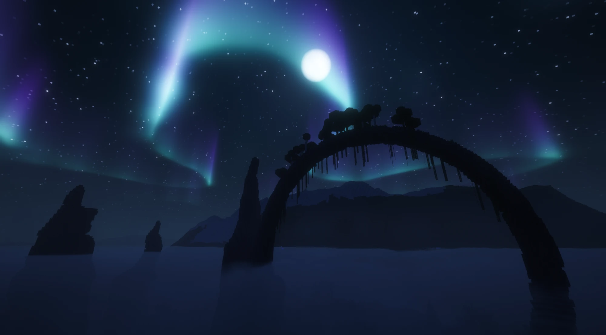
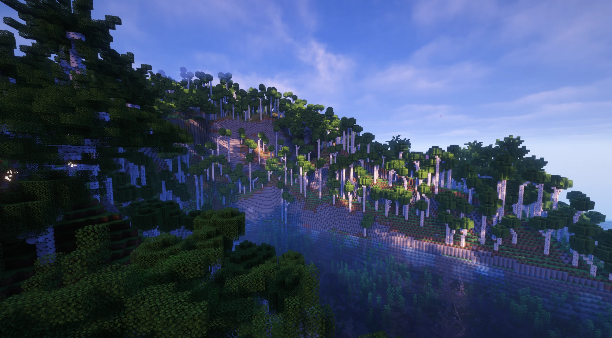
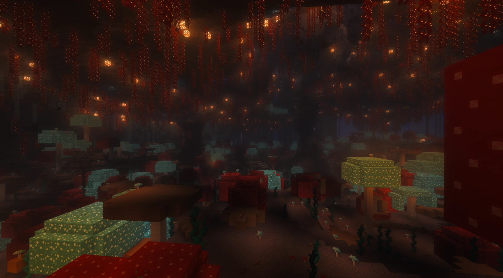

# Grand Atlas


One-stop terrain and biomes for **Minecraft 1.21.1 on NeoForge** (a 26.3 version builds from the same sources and will follow): oversized real-world and fantasy landforms, real river systems and a world that runs from y -512 to 1024, blended without seams. Download it on Modrinth; the player-facing description and the roadmap are in [MODRINTH.md](MODRINTH.md).

## Screenshots

> [!NOTE]
> Some of these screenshots were taken in the **Create Atlas** modpack, so they can show things that are not part of Grand Atlas, such as blocks, builds and mobs from the pack's other mods (the airships in the first shot, for example). Grand Atlas makes the terrain, biomes, caves and features. Every shot uses a shader pack, so lighting and sky look different without one.

<p align="center">
  
</p>
<p align="center"><em>A stratovolcano in the Volcanic Wastes, lava veining its slopes, with desert crags behind. The airships come from the Create Atlas modpack.</em></p>

<p align="center">
  
  
</p>
<p align="center"><em>Left: a natural arch and sea stacks under the aurora. Right: the aurora over a sea inlet.</em></p>

<p align="center">
  
  
</p>
<p align="center"><em>Left: a great oak over mixed forest and a cherry grove, with rock towers and a floating rock in the mist. Right: a flower glade in old-growth taiga.</em></p>

<p align="center">
  
  
</p>
<p align="center"><em>Left: birch woods on the steep shore of a lake. Right: the night sky over a violet crystal spire.</em></p>

<p align="center">
  
  
</p>
<p align="center"><em>Left: a fungal forest underground, giant glowcaps and mushrooms under red weeping vines. Right: root caves under a forest.</em></p>

**Status: M2 done (landform framework + macro landforms).** The world is 1152 blocks tall. Continents and tectonic belts set a base height (the datum), and a warped mosaic of ~1.6 km provinces each holds one landform that builds relief over it:
- **Wonders:** megaranges with cirques, canyon plateaus, dune seas, playas with salt flats, and rock deserts (Wadi Rum-style sandstone jebels, towers and fins carved in 3D with holes, arches and undercut feet).
- **Ordinary country:** lowlands, hills and highlands.

**Rivers (0.0.4, rebuilt in 0.0.6):** a watershed network over all land. Rain drains downhill to the sea, springs become streams, streams join into rivers up to 80 blocks wide, and lakes fill real hollows. Rivers follow the valley floor and only ever cut the ground down. Near the coast they run at sea level. Higher up they step down in pools and waterfalls, and they cut gorges through rises. Their water is Grand Atlas's River Water: it stays put instead of spreading, but carries a current that pushes swimmers, mobs, items and boats downstream (`RiverWater.current` exposes it to physics mods).

**Meso and micro features (0.0.7):** inside provinces, meso sites 140-600 blocks across (pond country, sinkhole fields with cenotes, hoodoo gardens, cinder fields, forest glades) lay out micro features (ponds, sinkholes, hoodoos, cinder cones, basalt columns) dressed with detail (lily pads, vines, boulders, fallen logs). See [docs/MICRO_FEATURES.md](docs/MICRO_FEATURES.md).

Blending is seamless. Canyon plateaus end in cliffs; softer landforms taper into each other. Biomes come from each landform's zones, including Grand Atlas's own Salt Flat, Red Desert and River. Vanilla caves are lightly damped inside tall mountains, and Grand Atlas adds its own: pits that drop 60-160 blocks, fissures, and caverns.

**M2 (macro landforms):** one every 5-6 km, a macro lays down a foundation and a whole sub-mosaic of ordinary terrain generates on top of it:
- **Great Plateau:** cliff walls with ramps, and on top a landmark summit, a lake, and a river that pours off the rim as a waterfall.
- **Mountain massif:** a domed mountain mass.
- **Enclosed basin:** a rim ring with passes.
- **Elevated mesa:** a stepped edge.

`/grandatlas where` shows the whole stack, e.g. `great_plateau → interior → lowlands → plain`.

## Layout

| Piece | Where |
|---|---|
| Terrain maths (pure Java, no Minecraft) | `src/main/java/.../core`: `AtlasCore` (column pipeline + blender), `world/WorldField` (continents, belts, basins, datum, climate, rain shadow), `province/ProvinceMosaic`, `landform/` (`Frame`, `Landform`, `Ordinary`, `Megarange`, `CanyonPlateau`, `DuneSea`, `Playa`, `RockDesert`, `Rocks`), `Caves`, `macro/` (`MacroField`, `Macro`, `GreatPlateau`, `Massif`, `Basin`, `ElevatedMesa`), `noise/`, `BiomeKind`, `Biomes` |
| Density functions | `world/TerrainDensity` (`grandatlas:terrain`: the ground before rivers, interpolated), `world/ClimateDensity` (`grandatlas:climate`), `world/CaveDamping` (`grandatlas:cave_damping`), `world/GrandCaves` (`grandatlas:caves`: our caves, the per-block wind carving, and the exact river cut) |
| Rivers and lakes | `core/hydro/Drainage` (the watershed network: nodes, flow with breached pits, catchment, levels, routed courses, pools, lakes in real basins, the lowering-only carve), `CoastDistance`, `TileCache` |
| River water | `world/RiverWater` (`grandatlas:river_water`: `RiverWaterFluid`, `RiverWaterBlock`, `RiverFlow`, and `current()` for physics mods), `mixin/WaterFluidMixin` (vanilla water counts it as its own), `GrandAtlasClient` (drawn as water) |
| Perched water | `world/PerchedWater` (`grandatlas:perched_water`): fills rivers and lakes with river water and their currents, pours ordinary water where they meet open air, and plugs carver holes beside and under them |
| Biome source | `world/AtlasBiomeSource` (`grandatlas:atlas`) |
| Seed → core | `world/CoreHandle`: one core per world seed, found again from the climate sampler |
| Deep lava fix | `mixin/NoiseBasedChunkGeneratorMixin`: vanilla's lava level of -54 follows the floor instead (-118) |
| Worldgen data | Generated by `tools/gen_data.py` from vanilla's own 26.3 files: dimension, noise settings, our density functions, the `grandatlas:overworld` material rule (ours ahead of vanilla's), the Salt Flat biome, tags and lang. Don't hand-edit `src/main/resources/data`. |
| Commands | `/grandatlas where` (tag stack and numbers), `/grandatlas locate <landform or macro>`, `/grandatlas seed` (to preview the live world) |

## Build and test

```
gradlew build                       # -> build/libs/grandatlas-<ver>.jar (Java 25)
gradlew checkCore                   # determinism, seams, bounds, land fraction, neighbour rules, coverage, macro placement and edges, rivers reach the sea, river water contained
gradlew preview                     # preview/map.png, biomes.png, landforms.png (macro outlines), section.png + census and macro list
gradlew preview -Pargs="--seed 7 --size 32768 --scale 32"
python tools/gen_data.py            # regenerate worldgen JSON (needs one gradle build first)
```

Playtest: `python tools/make_playtest_mrpack.py` builds `dist/grand-atlas-playtest-<ver>.mrpack` for the Modrinth App (Grand Atlas + Distant Horizons, Xaero's maps, light performance mods; release builds only). [docs/PLAYTEST.md](docs/PLAYTEST.md) is the tour and checklist. `gradlew runPlaytest` is a dev-client smoke test that loads `run/saves/GA-Test` straight away.

**Two versions build from this folder** (since 2026-11-11): Minecraft 26.3 from the root project and Minecraft 1.21.1 from `mc1211/`, which compiles the same `core/` sources ([docs/BACKPORT_1.21.1_PLAN.md](docs/BACKPORT_1.21.1_PLAN.md)). A bare task name runs in both, so name the project: `gradlew :build` and `gradlew :runServer` for 26.3, `gradlew :mc1211:build` and `gradlew :mc1211:runServer` for 1.21.1 (`mc1211/run`, RCON port 25601). Data for 1.21.1: `python tools/gen_data.py --target 1.21.1`.

Dev server: `gradlew :runServer` uses `run/` (seed `grand-atlas`, RCON on port 25600, password `atlas`).

```
python tools/rcon.py "grandatlas seed" "grandatlas where" "grandatlas locate canyon_plateau"
python tools/rcon.py "forceload add 128 96 383 351" "save-all flush"
python tools/render_region.py run/world/dimensions/minecraft/overworld 128 96 383 351 224
```

`forceload` caps at 256 chunks per call and counts every chunk touched, so use chunk-aligned ranges (multiples of 16, ending on 15). In 26.x, region files live under `world/dimensions/minecraft/overworld/region`.

## License

Grand Atlas uses its own [Grand Atlas License](LICENSE.md): free to use, change, port and share with credit; any modpack (monetized too) and any videos or streams are fine; servers only if they make no money; any other way of making money with it needs permission. The third-party trees and rock formations in [docs/CREDITS.md](docs/CREDITS.md) stay under their authors' terms and are not covered.

## Made with AI

This Mod was made with the help of Ai. All concepting, design, testing, as well as code review was performed by a human (Me!). I know how to Code in Java, but do not know the ins and outs of Minecraft modding and while I am learning most of the code in this project was generated with - Claude Code, Opus 5.5.
